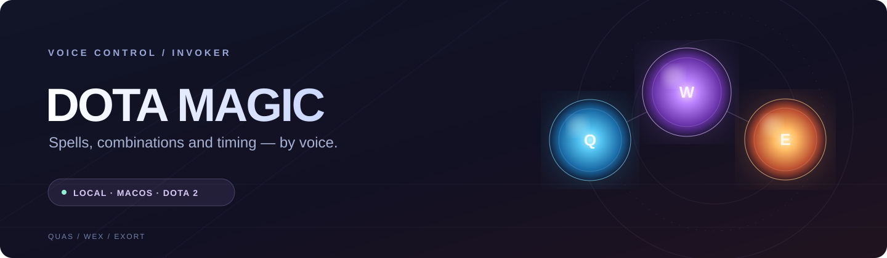

<div align="center">
  

  **Заклинания Invoker — голосом.** Локальное распознавание, четыре прокаста и тайминги с учётом сфер.

  
  
  
  

  [Быстрый старт](#быстрый-старт) · [Голосовые команды](#голосовые-команды) · [Прокасты](#прокасты) · [Как это работает](#как-это-работает) · [Документация](#документация)
</div>

---

## Возможности

- **Одна фраза — одно заклинание.** Программа проверяет ячейки, при необходимости вызывает способность через Invoke и применяет её.
- **Четыре голосовых прокаста.** Планировщик может переставлять заклинания, учитывать уровни сфер и подбирать время первых попаданий после Tornado.
- **Состояние из игры.** Dota Game State Integration передаёт уровни, доступность способностей и содержимое D/F на локальный сервер.
- **Локальная речь.** Whisper распознаёт фразы; Vosk отдельно слушает команду **«стоп»**. Для Whisper доступно ускорение Metal.
- **Реакция на смех.** Воспроизводится одна из трёх локально извлечённых реплик Invoker; для этой функции нужны дополнительные локальные файлы.

## Быстрый старт

Проект проверялся на **macOS с Apple Silicon и Python 3.15**. Нужны установленная Dota 2, микрофон и доступ приложению к **Микрофону** и **Универсальному доступу** macOS для отправки нажатий.

### 1. Подготовь окружение

Из корня проекта:

```bash
python3 -m venv .venv
.venv/bin/python -m pip install numpy sounddevice vosk pyautogui pyobjc-framework-Quartz pyobjc-framework-Cocoa
.venv/bin/python -m tools.download_whisper_model
```

Скрипт загружает модель Whisper и проверяет её SHA-256. Vosk и скомпилированный Whisper worker находятся в репозитории; установленная версия приложения использует модель `ggml-small-q5_1.bin` из `models/`.

### 2. Подключи игру

Добавь `-gamestateintegration` в параметры запуска Dota 2 в Steam. Скопируй [GSI-конфигурацию](integration/gamestate_integration_dota_magic.cfg) в папку игры:

```bash
mkdir -p "$HOME/Library/Application Support/Steam/steamapps/common/dota 2 beta/game/dota/cfg/gamestate_integration"
cp integration/gamestate_integration_dota_magic.cfg "$HOME/Library/Application Support/Steam/steamapps/common/dota 2 beta/game/dota/cfg/gamestate_integration/"
```

Если игра установлена в другой библиотеке Steam, используй соответствующий путь. Полностью перезапусти Dota после изменения конфигурации. В игре настрой **быстрое применение** и клавиши Invoker: `Q`, `W`, `E`, `R`, `D`, `F`.

### 3. Запусти DOTA MAGIC

```bash
.venv/bin/python main.py
```

Нажми **«Включить»**, переключись в тренировку Dota и наведи курсор на цель. Скажи **«стоп»** или нажми кнопку **«СТОП»**, чтобы выключить ввод.

> GSI передаёт состояние Invoker, но не положение выбранного противника. Расстояние до цели указывается приблизительно в окне; наведение и передвижение выполняются мышью. Расчёт таймингов не гарантирует попадание по движущейся или неуязвимой цели.

## Голосовые команды

| Заклинание | Кодовая фраза |
| :--- | :--- |
| Cold Snap | «Обрети хрупкость льда» |
| Ghost Walk | «Призрак Мирота» |
| Ice Wall | «Гибельная стена Корикса» |
| EMP | «Экстрагирующий Мана Пульс» |
| Tornado | «Когти Торнаруса» |
| Alacrity | «Рвение Эксорта» |
| Sun Strike | «Заклятье испепеления Харлека» |
| Forge Spirit | «Элементали Горя» |
| Chaos Meteor | «Пироклазм Бездны» |
| Deafening Blast | «Оглушающее Трио» |
| Invoke | «Слова силы» |

Также доступны отдельные команды **«Куас»**, **«Векс»**, **«Экзорт»**, **«Инвоук»**, **«Первый»** и **«Второй»**. Порог совпадения фраз относится к сходству распознанного текста, а не к вероятности правильного распознавания речи.

## Прокасты

| Кодовая фраза | Состав |
| :--- | :--- |
| **«Мама, я Миракл!»** | Tornado · EMP · Chaos Meteor · Deafening Blast |
| **«От меня не убежишь»** | Ice Wall · Cold Snap · Forge Spirit · Alacrity на Invoker |
| **«Мой любимый 2007-й»** | Tornado · Cold Snap · Sun Strike · Chaos Meteor · Deafening Blast |
| **«Рэмпейдж» / Rampage** | Cold Snap · Tornado · EMP · Sun Strike · Chaos Meteor · Forge Spirit · Alacrity на Invoker · Deafening Blast |

Порядок может меняться ради синхронизации. У «Рэмпейдж» Cold Snap применяется первым, Deafening Blast — последним. Если расчёт не находит общего окна попадания после Tornado, включённый по умолчанию флажок в окне останавливает запуск и показывает причину.

Векторный Ice Wall с соответствующим улучшением Scepter пока не поддерживается: такой прокаст блокируется с пояснением.

## Как это работает

```text
Микрофон ──► Whisper ──► фраза / прокаст ──► планировщик ──► клавиши в Dota
                  ▲              ▲                  ▲
                  │         база Invoker       уровни и ячейки из GSI
              локальная                         127.0.0.1:38742
                модель
```

База строится из параметров **установленной игры** и охватывает уровни героя 1–30 и сфер 0–9. При смене исходного файла игры хеш меняется, и приложение пересобирает базу при следующем запуске. Сетка включает и математические сочетания, недостижимые в обычном матче.

Проверка GSI и отправка клавиш выполняются отдельно. В журнале различаются **отправленная команда**, **перезарядка, увиденная GSI**, и **расчётный момент попадания**. Если способность уже вытеснена из ячеек, GSI может не успеть подтвердить её применение.

## Документация

| Раздел | Что внутри |
| :--- | :--- |
| [Уровни Invoker и тайминги](docs/INVOKER_TIMING.md) | База, формулы, планировщик и ограничения модели |
| [Задержка и диагностика](docs/LATENCY.md) | Метки времени и локальный стенд |
| [Проверка смеха](experiments/laughter/README.md) | Apple Sound Analysis и локальные реплики |

<details>
<summary><strong>Структура проекта и служебные команды</strong></summary>

| Путь | Назначение |
| :--- | :--- |
| `main.py` | Запуск и окно программы |
| `dota_magic/` | Голосовое управление, прокасты и тайминги |
| `data/` | База Invoker и извлечённые числовые правила |
| `docs/` | Инструкции |
| `integration/` | GSI и компоненты Whisper |
| `models/` | Локальные модели |
| `tools/` | Диагностика и служебные команды |
| `tests/` | Автоматические тесты |
| `experiments/` | Камера, руки, смех и проверка ввода |
| `outputs/` | Отчёты и резервная копия GSI-конфигурации |
| `logs/` | Рабочий журнал Whisper |

```bash
# Тесты
.venv/bin/python -m unittest discover -s tests -q

# Профиль Invoker и план при указанных уровнях и дистанции
.venv/bin/python -m dota_magic.invoker_database --hero-level 30 --quas 8 --wex 8 --exort 9
.venv/bin/python -m dota_magic.combo_timing --hero-level 30 --quas 8 --wex 8 --exort 9 --distance 600

# Проверка микрофона и фраз
.venv/bin/python -m tools.voice_test
.venv/bin/python -m tools.voice_phrase_test

# Камера и эксперимент с руками
.venv/bin/python experiments/camera/camera_test.py
.venv/bin/python experiments/hand_fun/magic_hands.py
```

</details>

---

<div align="center"><sub>Создано для исследования голосового управления Invoker в Dota 2.</sub></div>
